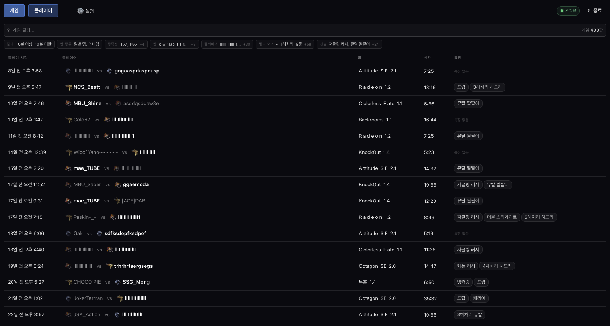
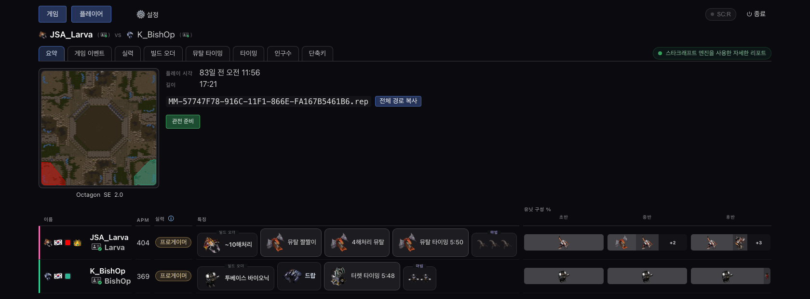
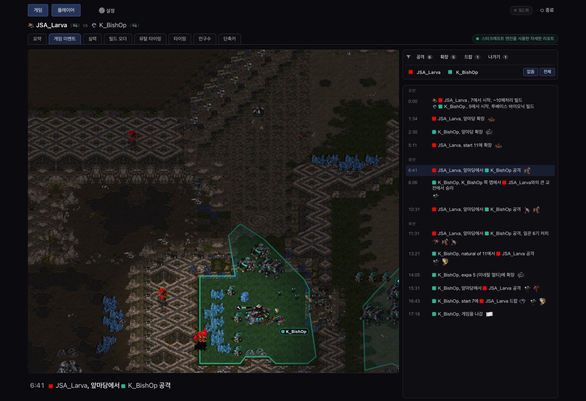
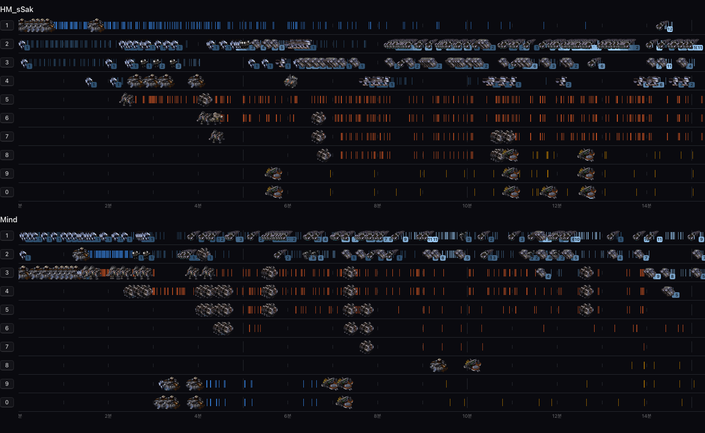
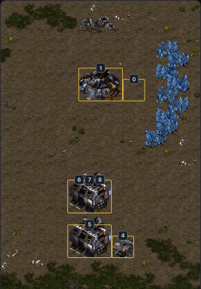
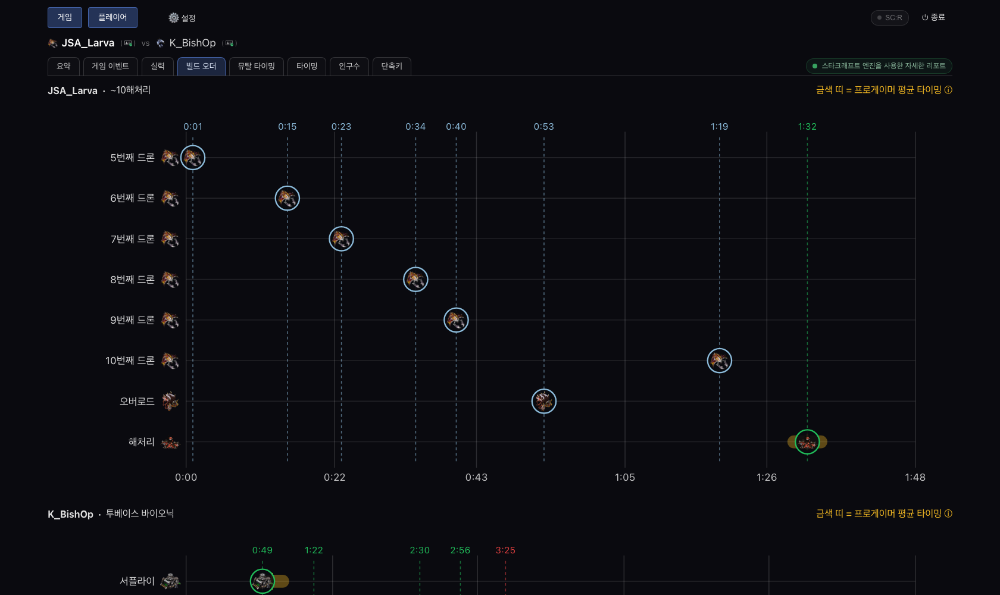
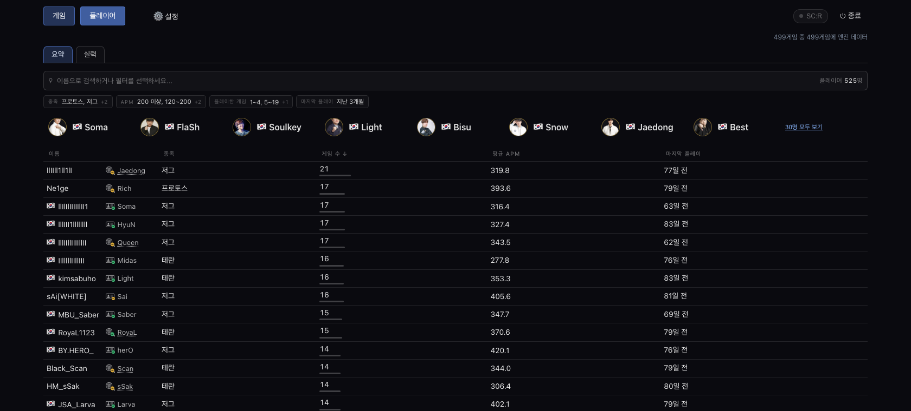
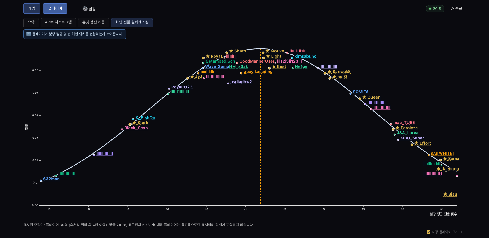
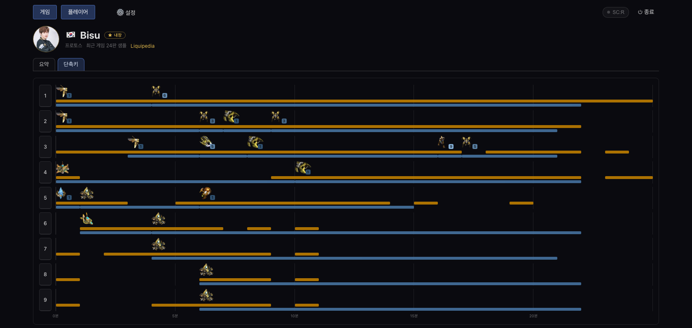
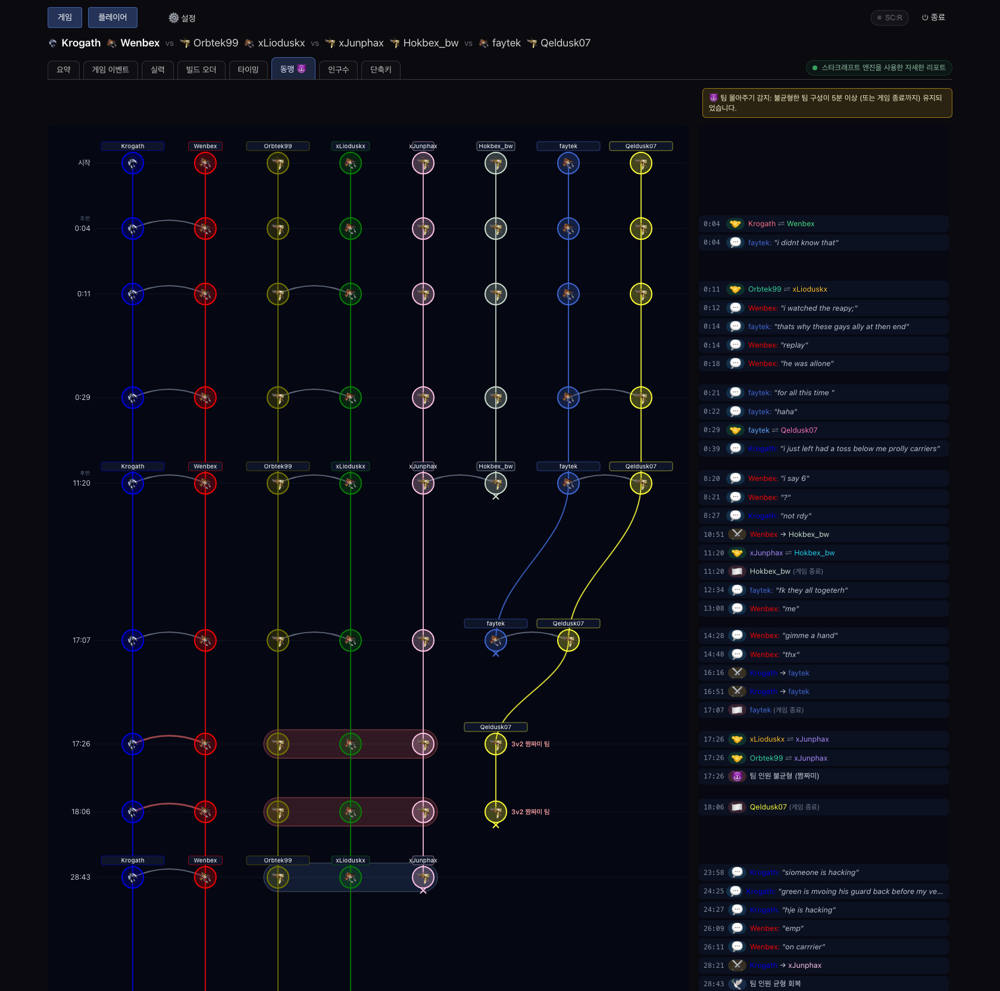

# screpdb

screpdb는 스타크래프트 리플레이를 위한 고급 분석 리포팅 도구입니다.

[English](README.md) | [한국어](README.ko.md)

[](https://github.com/marianogappa/screpdb/releases)
[](LICENSE)
[](go.mod)
[](scripts/coverage.sh)
[](.github/workflows/bench-load.yml)

**▶️ [브라우저에서 바로 사용해 보기](https://marianogappa.github.io/screpdb/)** — 설치 없이 예시 리플레이로 전체 대시보드를 체험할 수 있고, 모든 처리는 브라우저에서 실행됩니다.

**⬇️ Windows에 설치:** PowerShell에 붙여 넣으세요.

```powershell
irm https://raw.githubusercontent.com/marianogappa/screpdb/main/install.ps1 | iex
```

macOS, Linux 및 다른 방법은 [설치](#설치)를 참고하세요.

## 주요 기능
### 고수준 의미 기반 특징으로 리플레이 필터링 및 검색


### 게임 요약: 플레이어별 주요 의미 기반 이벤트와 유닛 구성


### 맵 오버레이를 갖춘 풍부한 게임 이벤트 브라우저


### 단축키 분석: 각 플레이어가 어떤 키에 무엇을 두는지 게임 내내 추적


### 그리고 단축키가 지정된 건물을 지어진 위치 그대로 맵 위에 표시


### 빌드 오더 감지: 초반 명령 중복 제거를 거쳐 프로게이머 평균 타이밍과 비교


### 내 리플레이의 플레이어와 나란히 표시되는 내장 프로게이머 프로필


### 실력 지표: 화면 전환 멀티태스킹, 유닛 생산 리듬, 첫 유닛 효율


### 내장 프로게이머를 포함한 플레이어별 단축키 시그니처


### 멀티플레이어 밀리 게임의 동맹 타임라인과 팀 몰아주기 감지


## 설치

**Windows**

```powershell
irm https://raw.githubusercontent.com/marianogappa/screpdb/main/install.ps1 | iex
```

PowerShell에 붙여 넣으세요. screpdb가 브라우저에서 열리고 시작 메뉴 바로 가기가 생깁니다. [스크립트 보기](install.ps1).

<details>
<summary><strong>Linux</strong></summary>

```bash
curl -fsSL https://raw.githubusercontent.com/marianogappa/screpdb/main/install.sh | sh
```

또는 Homebrew / Linuxbrew로:

```bash
brew install marianogappa/screpdb/screpdb   # upgrade later: brew update && brew upgrade screpdb
```

그다음 `screpdb`를 실행하세요. 업그레이드는 설치 스크립트를 다시 실행하거나 앱 내 **업데이트** 버튼을 사용하세요.

<details>
<summary>설치 스크립트를 먼저 읽거나 수동으로 설치하기</summary>

[`install.sh`](install.sh)는 짧고 의존성이 없습니다. 사용 중인 OS/아키텍처용 바이너리를 내려받아 릴리스의 서명된 `SHA256SUMS`와 대조하고 `~/.local/bin`에 복사합니다. 실행 전에 검토하려면:

```bash
curl -fsSL https://raw.githubusercontent.com/marianogappa/screpdb/main/install.sh -o screpdb-install.sh
less screpdb-install.sh
sh screpdb-install.sh
```

또는 [릴리스 페이지](https://github.com/marianogappa/screpdb/releases)에서 바이너리를 직접 내려받으세요:

```bash
chmod +x screpdb-linux-amd64                              # or screpdb-linux-arm64
mkdir -p ~/.local/bin && mv screpdb-linux-amd64 ~/.local/bin/screpdb
```

</details>

</details>

<details>
<summary><strong>macOS</strong></summary>

```bash
brew install marianogappa/screpdb/screpdb   # upgrade later: brew update && brew upgrade screpdb
```

Homebrew 없이 설치하려면:

```bash
curl -fsSL https://raw.githubusercontent.com/marianogappa/screpdb/main/install.sh | sh
```

그다음 `screpdb`를 실행하세요. 두 방법 모두 Gatekeeper의 "확인되지 않은 개발자" 차단이 없습니다.

<details>
<summary>직접 다운로드를 원하시나요? (이 방법은 Gatekeeper에 <em>걸립니다</em>)</summary>

[릴리스 페이지](https://github.com/marianogappa/screpdb/releases)에서 Mac에 맞는 바이너리를 내려받은 뒤:

```bash
chmod +x screpdb-darwin-arm64                          # or screpdb-darwin-amd64
xattr -d com.apple.quarantine screpdb-darwin-arm64     # clear the browser-download quarantine
mkdir -p ~/.local/bin && mv screpdb-darwin-arm64 ~/.local/bin/screpdb
```

앱 내 업데이트 버튼이 작동하도록 쓰기 가능한 폴더(`~/Downloads`나 Homebrew prefix 제외)에 두세요.

</details>

</details>

<details>
<summary><strong>Windows: Scoop 또는 직접 다운로드</strong></summary>

<details>
<summary>Scoop을 선호하시나요? (<code>screpdb</code> CLI도 함께 설치됩니다)</summary>

```powershell
scoop install git   # required by 'scoop bucket add' (skip if you already have git)
scoop bucket add screpdb https://github.com/marianogappa/screpdb
scoop install screpdb
```

앱은 **`screpdb-gui`**, CLI는 `screpdb`로 실행합니다. 업그레이드는 `scoop update screpdb`입니다. 예전 버전이 보이면 먼저 (패키지 이름 없이) `scoop update`를 실행해 버킷을 갱신하세요.

Scoop이 아직 없다면 먼저 설치하세요:

```powershell
Set-ExecutionPolicy -ExecutionPolicy RemoteSigned -Scope CurrentUser
irm get.scoop.sh | iex
```

</details>

<details>
<summary>직접 다운로드를 원하시나요? (SmartScreen 경고가 표시됩니다)</summary>

[릴리스 페이지](https://github.com/marianogappa/screpdb/releases)에서 **`screpdb-gui-windows-amd64.exe`**(앱. CLI는 `screpdb-windows-amd64.exe`)를 내려받으세요. 바이너리는 **코드 서명이 되어 있지 않아** 첫 실행 시:

- **SmartScreen "Windows의 PC 보호"**: **추가 정보 → 실행**을 클릭하세요.
- **Defender나 다른 백신**이 격리할 수 있습니다(서명되지 않은 Go 바이너리의 알려진 오탐). 보호 기록에서 복원하세요.
- AppLocker나 WDAC가 적용된 **회사 PC**에서는 완전히 차단될 수 있습니다.

앱 내 업데이트 버튼이 작동하도록 `.exe`를 `%LOCALAPPDATA%\Programs\screpdb\`처럼 쓰기 가능한 폴더에 두세요. [소스에서 빌드](#소스에서-빌드하기)할 수도 있습니다.

</details>

</details>

🛡️ **보안:** Windows에서는 screpdb가 낮은 무결성(Low integrity) 샌드박스에서 실행되므로, 리플레이 파서가 침해되더라도 screpdb 자체 데이터 폴더에만 쓸 수 있습니다. macOS와 Linux에는 아직 OS 샌드박스가 없으며, 쓰기는 프로세스 내에서 앱 데이터 폴더와 리플레이 폴더로 제한됩니다. [영어 README의 Security / I/O model](README.md#security--io-model)을 참고하세요.

릴리스 노트는 [CHANGELOG.md](CHANGELOG.md)를 참고하세요.

### 소스에서 빌드하기

Go 1.25.2 이상이 필요합니다. 내장 대시보드 UI 자산을 먼저 다시 빌드하도록 (`go build`만 실행하지 말고) `make build`를 사용하세요:

```bash
git clone https://github.com/marianogappa/screpdb.git
cd screpdb
make build
```

## 제거

**1. 바이너리 삭제**

| 설치 방법 | 명령 |
| --- | --- |
| Windows 설치 스크립트 (`install.ps1`) | `Remove-Item -Recurse "$env:LOCALAPPDATA\Programs\screpdb", "$([Environment]::GetFolderPath('Programs'))\screpdb.lnk"` |
| Scoop (Windows) | `scoop uninstall screpdb` |
| Homebrew (macOS/Linux) | `brew uninstall screpdb` |
| 한 줄 설치 스크립트 / 수동 설치 | 직접 넣은 바이너리를 삭제하세요 (예: `~/.local/bin/screpdb`) |

**2. 데이터 폴더 삭제**(선택 사항. 나중에 다시 설치할 때 데이터를 유지하려면 건너뛰세요.)

```bash
# Windows (PowerShell)
Remove-Item -Recurse -Force "$env:LOCALAPPDATA\screpdb"

# macOS
rm -rf "$HOME/Library/Application Support/screpdb"

# Linux
rm -rf "${XDG_CONFIG_HOME:-$HOME/.config}/screpdb"
```

## 한국어 UI

브라우저(시스템) 언어가 한국어이면 대시보드가 자동으로 한국어로 표시됩니다. 오른쪽 아래 푸터의 English / 한국어 전환 스위치로 언제든 언어를 바꿀 수 있습니다.

번역 수정 제안은 [이슈](https://github.com/marianogappa/screpdb/issues/new/choose)로 환영합니다. 번역 텍스트는 `internal/dashboard/frontend/src/locales/ko/`에 있습니다.

## 개발자 기능

`screpdb dashboard --headless`는 UI 없이 JSON API 서버만 실행하며, 모든 UI 기능이 OpenAPI 스키마와 함께 API로 제공됩니다. `screpdb mcp`로 MCP 클라이언트(Claude Desktop, Claude Code, Cursor 등)에서 게임, 플레이어, 종족전, 빌드 오더에 대해 자연어로 질문할 수 있습니다. 명령별 옵션은 [영어 README의 Developer features 참고](README.md#developer-features).

screpdb의 API나 MCP 위에 무언가를 만들고 싶다면 알려주세요. 기꺼이 도울 의향이 있지만, 그런 요청 없이 검증되지 않은 기능을 추가하지는 않습니다.

## 사양: 수치가 계산되는 방식

"9풀", "스포닝 풀이 6초 늦음", "질럿 생산 25.2초" 같은 앱의 모든 골든 값(유닛 이름, 빌드 시간, 프로 타이밍, 비용, 테크 트리 규칙, 감지 임계값)은 [SPECIFICATION.md](SPECIFICATION.md)에 문서화되어 있습니다. 이 문서는 Go 소스에서 `go generate ./...`로 생성되고 테스트로 검증되므로 코드와 어긋날 수 없습니다. 릴리스 다운로드를 `SHA256SUMS`와 minisign 서명으로 검증하는 방법도 같은 절에 있습니다. [영어 README의 Specification 참고](README.md#specification--how-the-numbers-are-computed).

## 보안 / I/O 모델

screpdb는 모든 디스크와 네트워크 접근을 `internal/iofacade` 등 파사드로만 처리해 공격 표면을 최소화합니다. 쓰기는 OS별 단일 앱 데이터 디렉터리와 설정된 리플레이 폴더로 제한되고, 대시보드 서버는 `localhost`에만 바인딩되며, 외부 호출은 사용자가 직접 실행하는 자체 업데이트(minisign 서명 검증)와 배틀넷 리플레이 다운로드에 한정됩니다. Windows에서는 낮은 무결성 워커가 실제 OS 쓰기 경계를 추가하고, `TestNoDirectIOOutsideFacades` 테스트가 파사드를 우회하는 코드를 CI에서 차단합니다. 자세한 내용과 I/O 안전 감사 기록은 [영어 README의 Security / I/O model 참고](README.md#security--io-model).

## 라이선스, 기여 및 감사의 말

이 프로젝트는 MIT 라이선스로 배포됩니다([LICENSE](LICENSE) 참고). 보안상의 이유로 코드 PR은 받지 않지만 [이슈](https://github.com/marianogappa/screpdb/issues) 제출과 코드 외 기여는 언제나 환영합니다. 리플레이 파싱은 [András Belicza](https://github.com/icza)의 [github.com/icza/screp](https://github.com/icza/screp) 라이브러리에 기반합니다. [영어 README의 License, Contributing & Acknowledgements 참고](README.md#license-contributing--acknowledgements).
