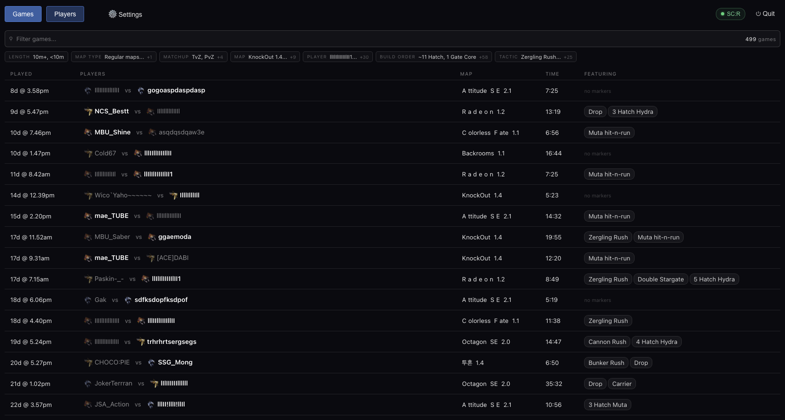
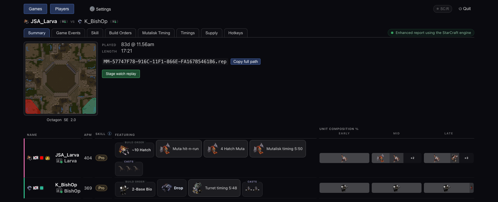
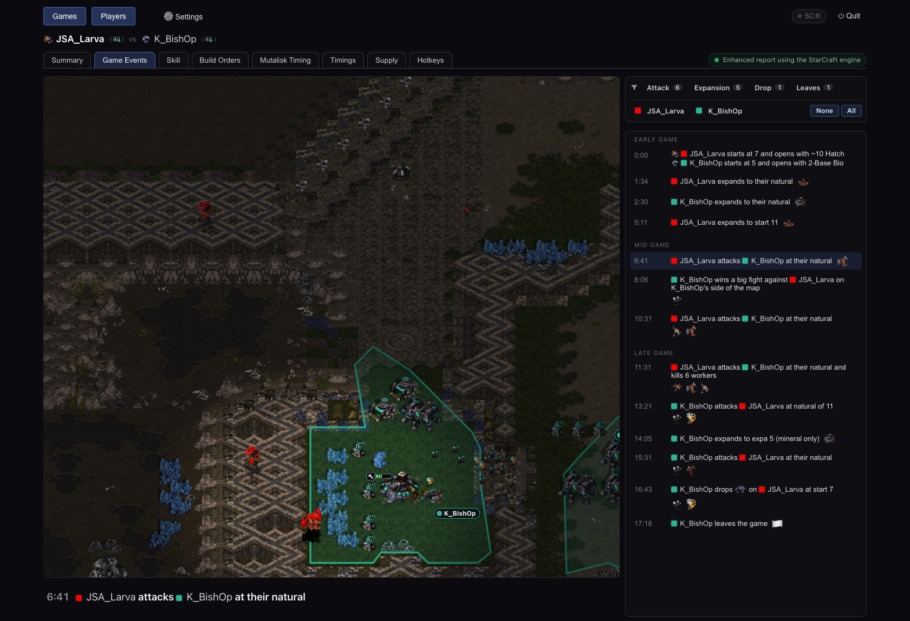
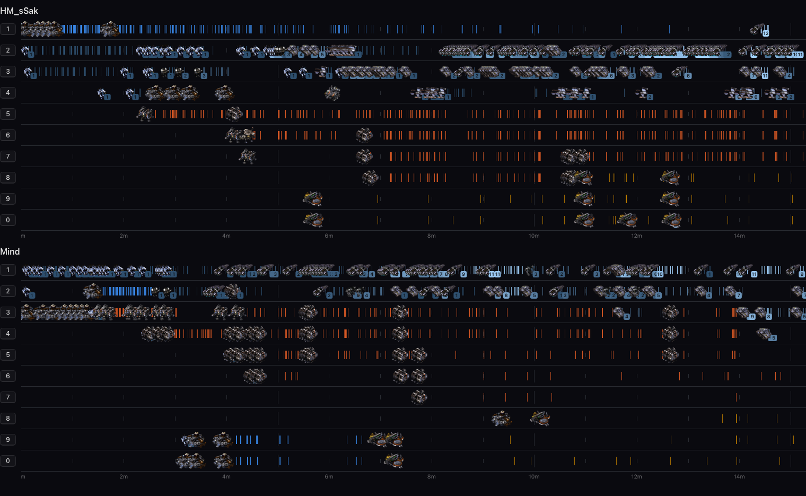
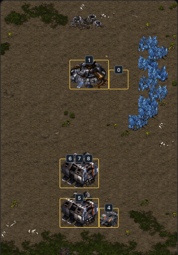
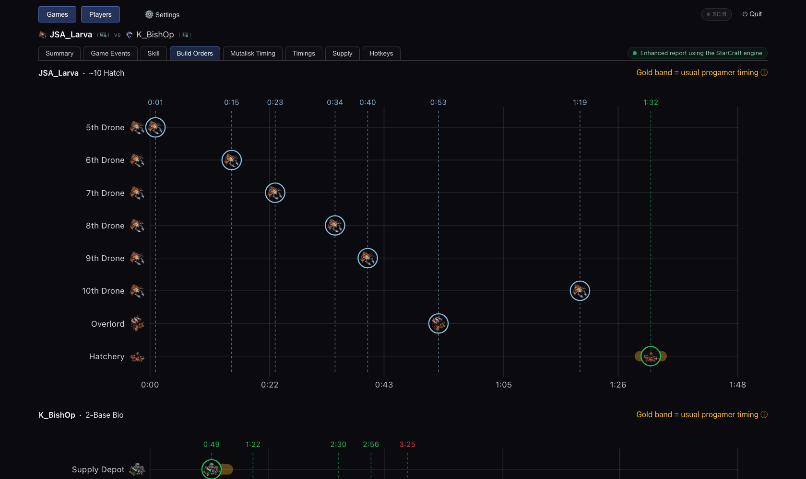
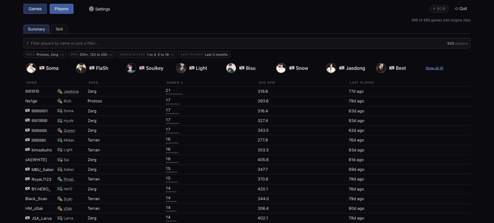
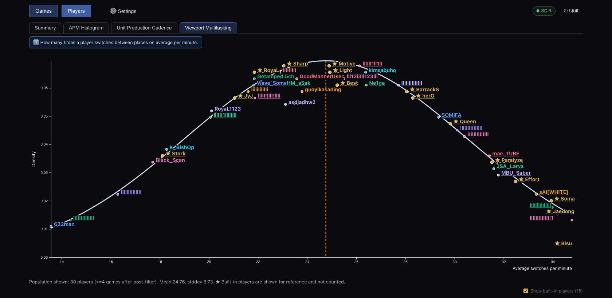
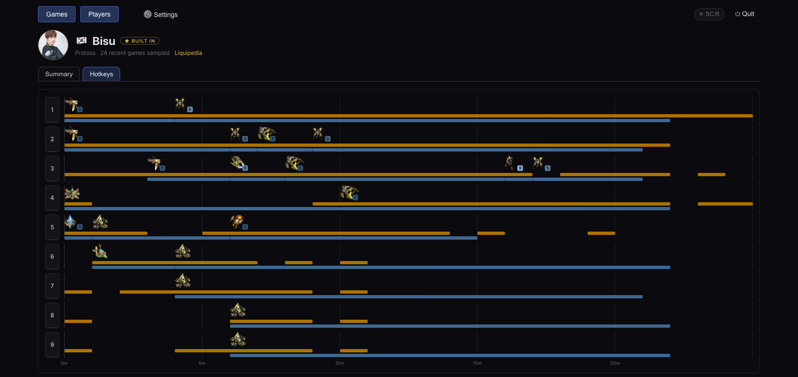
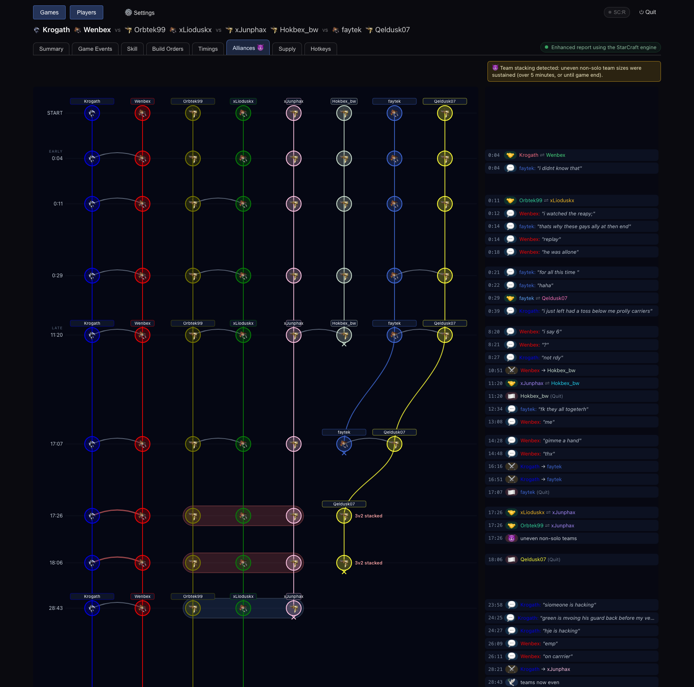

# screpdb

screpdb is an advanced Starcraft replay reporting tool.

[English](README.md) | [한국어](README.ko.md)

[](https://github.com/marianogappa/screpdb/releases)
[](LICENSE)
[](go.mod)
[](scripts/coverage.sh)
[](.github/workflows/bench-load.yml)

<!-- load-bench-start -->
<sub>28.88 ms/replay · corpus: 166 replays · GitHub-hosted 2-core runner · updated automatically on merge to main</sub>
<!-- load-bench-end -->

**▶️ [Try it in your browser](https://marianogappa.github.io/screpdb/)** — the full dashboard on sample replays, no install, runs entirely client side.

**⬇️ Install on Windows:** paste into PowerShell.

```powershell
irm https://raw.githubusercontent.com/marianogappa/screpdb/main/install.ps1 | iex
```

macOS, Linux and other options: see [Installation](#installation).

## Features
### Filtering and finding replays by high-level semantic features


### Game summary: each player's noteworthy semantic events and unit composition


### Rich game events browser with map overlays


### Hotkey intel: what each player keeps on which key, all game long


### …and the hotkeyed buildings drawn on the map where they were built


### Build order detection, de-duped and charted against usual progamer timings


### Built-in progamer profiles alongside the players in your own library


### Skill proxies: viewport multitasking, unit production cadence, first unit efficiency


### Per-player hotkey signature, including the built-in progamers


### Alliance timeline and team stacking detection on multiplayer melee games


## Installation

**Windows**

```powershell
irm https://raw.githubusercontent.com/marianogappa/screpdb/main/install.ps1 | iex
```

Paste into PowerShell. screpdb opens in your browser and gets a Start Menu shortcut. [Read the script](install.ps1).

<details>
<summary><strong>Linux</strong></summary>

```bash
curl -fsSL https://raw.githubusercontent.com/marianogappa/screpdb/main/install.sh | sh
```

Or with Homebrew / Linuxbrew:

```bash
brew install marianogappa/screpdb/screpdb   # upgrade later: brew update && brew upgrade screpdb
```

Then run `screpdb`. Upgrade by re-running the installer or with the in-app **Update** button.

<details>
<summary>Read the installer first, or install manually</summary>

[`install.sh`](install.sh) is short and dependency-free: it downloads the binary for your OS/arch, checks it against the release's signed `SHA256SUMS`, and copies it to `~/.local/bin`. To audit before running:

```bash
curl -fsSL https://raw.githubusercontent.com/marianogappa/screpdb/main/install.sh -o screpdb-install.sh
less screpdb-install.sh
sh screpdb-install.sh
```

Or download the binary from the [Releases page](https://github.com/marianogappa/screpdb/releases) yourself:

```bash
chmod +x screpdb-linux-amd64                              # or screpdb-linux-arm64
mkdir -p ~/.local/bin && mv screpdb-linux-amd64 ~/.local/bin/screpdb
```

</details>

</details>

<details>
<summary><strong>macOS</strong></summary>

```bash
brew install marianogappa/screpdb/screpdb   # upgrade later: brew update && brew upgrade screpdb
```

Or, without Homebrew:

```bash
curl -fsSL https://raw.githubusercontent.com/marianogappa/screpdb/main/install.sh | sh
```

Then run `screpdb`. Neither method triggers the Gatekeeper "unidentified developer" block.

<details>
<summary>Prefer a direct download? (this one <em>does</em> hit Gatekeeper)</summary>

Download the binary for your Mac from the [Releases page](https://github.com/marianogappa/screpdb/releases), then:

```bash
chmod +x screpdb-darwin-arm64                          # or screpdb-darwin-amd64
xattr -d com.apple.quarantine screpdb-darwin-arm64     # clear the browser-download quarantine
mkdir -p ~/.local/bin && mv screpdb-darwin-arm64 ~/.local/bin/screpdb
```

Keep it in a writable folder (not `~/Downloads` or a Homebrew prefix) so the in-app Update button works.

</details>

</details>

<details>
<summary><strong>Windows: Scoop or direct download</strong></summary>

<details>
<summary>Prefer Scoop? (also installs the <code>screpdb</code> CLI)</summary>

```powershell
scoop install git   # required by 'scoop bucket add' (skip if you already have git)
scoop bucket add screpdb https://github.com/marianogappa/screpdb
scoop install screpdb
```

Run **`screpdb-gui`** for the app or `screpdb` for the CLI. Upgrade with `scoop update screpdb`. Seeing an old version? Run `scoop update` (no package name) first to refresh the bucket.

No Scoop yet? Install it first:

```powershell
Set-ExecutionPolicy -ExecutionPolicy RemoteSigned -Scope CurrentUser
irm get.scoop.sh | iex
```

</details>

<details>
<summary>Prefer a direct download? (expect a SmartScreen warning)</summary>

Grab **`screpdb-gui-windows-amd64.exe`** (the app; `screpdb-windows-amd64.exe` is the CLI) from the [Releases page](https://github.com/marianogappa/screpdb/releases). The binaries are **not code-signed**, so on first launch:

- **SmartScreen "Windows protected your PC"**: click **More info → Run anyway**.
- **Defender or other antivirus** may quarantine it (a known false positive for unsigned Go binaries). Restore it from Protection History.
- **Work PCs** with AppLocker or WDAC may block it outright.

Put the `.exe` in a folder you can write to, such as `%LOCALAPPDATA%\Programs\screpdb\`, so the in-app Update button works. You can also [build from source](#building-from-source).

</details>

</details>

🛡️ **Secured:** on Windows, screpdb runs sandboxed at Low integrity, so even a compromised replay parser can only write to screpdb's own data folder. On macOS and Linux there is no OS sandbox yet; writes are confined in-process to the app-data and replays folders. See [Security / I/O model](#security--io-model).

See [CHANGELOG.md](CHANGELOG.md) for release notes.

### Building from source

You'll need Go 1.25.2 or later. Use `make build` (not a bare `go build`) so the embedded dashboard UI assets are rebuilt first:

```bash
git clone https://github.com/marianogappa/screpdb.git
cd screpdb
make build
```

## Uninstall

**1. Remove the binary**

| Installed with | Command |
| --- | --- |
| Windows installer (`install.ps1`) | `Remove-Item -Recurse "$env:LOCALAPPDATA\Programs\screpdb", "$([Environment]::GetFolderPath('Programs'))\screpdb.lnk"` |
| Scoop (Windows) | `scoop uninstall screpdb` |
| Homebrew (macOS/Linux) | `brew uninstall screpdb` |
| One-line installer / manual | Delete the binary you placed (e.g. `~/.local/bin/screpdb`) |

**2. Delete the data folder** (optional — skip this to keep your data for a future reinstall).

```bash
# Windows (PowerShell)
Remove-Item -Recurse -Force "$env:LOCALAPPDATA\screpdb"

# macOS
rm -rf "$HOME/Library/Application Support/screpdb"

# Linux
rm -rf "${XDG_CONFIG_HOME:-$HOME/.config}/screpdb"
```

## Developer features

<details>
<summary>MCP server and full OpenAPI — click to expand</summary>

- Server / API: `./screpdb dashboard` (also the default when run with no subcommand) starts the HTTP server and opens the dashboard UI. All UI functionality is exposed as a JSON API — [OpenAPI schema available](api/openapi/dashboard.v1.yaml). Run it headless as an API-only server (no UI, no browser) with `--headless`:

```bash
./screpdb dashboard --headless -p 8000
# then: curl http://localhost:8000/api/health
```

- MCP server: point an MCP client (Claude Desktop, Claude Code, Cursor, …) at your replays and ask questions in natural language about any game, player, matchup, build order, or event. A curated read-only subset of the API is reachable; nothing that changes local state is.

```bash
./screpdb mcp
```

If you want to build something on top of screpdb's API or MCP, let me know. I'm open to facilitating this, but I won't add untested features otherwise.

</details>

## Specification — how the numbers are computed

<details>
<summary>Every golden value — unit stats, build times, expert timings, detection thresholds — is generated from source and test-backed (see <code>SPECIFICATION.md</code>)</summary>

screpdb makes a lot of derived claims: "this is a **9 Pool**", "your Spawning
Pool was 6s late", "a Zealot takes 25.2s". Skeptical? Audit them.

[**SPECIFICATION.md**](SPECIFICATION.md) documents every golden value the app
relies on — unit names, build times, expert timings, costs, tech-tree rules,
detection thresholds, and more. It's:

- **Generated** from the Go source of truth (`go generate ./...`), so it can't drift from the code.
- **Test-backed** — CI fails if any value is wrong or the file is stale.

In short: not aspirational docs that rot, but a provably-accurate description of
what the app actually does.

</details>

<details>
<summary><strong>Verifying downloads</strong> — checksums + minisign signature</summary>

Each release publishes a `SHA256SUMS` file and a `SHA256SUMS.minisig` minisign signature alongside the binaries.

**Verify the checksum** (Linux/macOS):

```bash
sha256sum -c SHA256SUMS --ignore-missing
```

**Verify the checksum** (Windows PowerShell):

```powershell
Get-FileHash screpdb-windows-amd64.exe -Algorithm SHA256
# Compare the printed hash against the line in SHA256SUMS
```

**Verify the signature** (requires [minisign](https://jedisct1.github.io/minisign/)):

```bash
minisign -Vm SHA256SUMS -P 'RWS9gPPOydPD/tR8JBOelXKhif526NoAKY18dau7QHR4dqg84QMhJ5L/'
```

</details>

## Security / I/O model

screpdb minimizes its attack surface by routing all I/O through facades and keeping dependencies small (see [#135](https://github.com/marianogappa/screpdb/issues/135)). On **macOS and Linux** this is a best-effort, in-process guard; on **Windows** a Low-integrity worker adds a real OS write boundary.

<details>
<summary><strong>How the I/O model works</strong> — filesystem, Windows sandbox, network, self-update, enforcement</summary>

- **Filesystem** — all disk access goes through `internal/iofacade`, which permits reads/writes only within: a single per-OS **app-data directory** (`%LOCALAPPDATA%\screpdb` on Windows, `~/Library/Application Support/screpdb` on macOS, `$XDG_CONFIG_HOME/screpdb` on Linux) that holds settings, the Battle.net and game-asset caches, logs, crash reports, and extracted sample replays; and the configured replays folder (read replays, write "watch me" replays). A narrow, read-only exception walks up from the replays folder to find StarCraft's `CSettings.json`.
- **Windows OS sandbox** — on Windows the app splits into a Medium-integrity **launcher** and a **Low-integrity worker** ([#237](https://github.com/marianogappa/screpdb/issues/237)). The launcher marks the app-data directory Low-writable and relaunches the real worker at Low integrity; the worker keeps read-down access to replays anywhere but can only *write* into that one Low-labeled folder — every other write is refused by the OS, even from a compromised `screp`/`scmapanalyzer` parser. The launcher retains self-update (it must overwrite the install `.exe`) and brokers the single "watch me" write into the read-only replays folder on the worker's behalf. This does **not** stop a compromised parser from *reading* private files (Low integrity can read up-level); blocking reads needs AppContainer + a broker process, a deferred "Tier 2" follow-up.
- **Network** — the dashboard server binds to `localhost` only. The binary's outbound calls are confined to three sanctioned packages: **`internal/selfupdate`** ([#212](https://github.com/marianogappa/screpdb/issues/212)) queries GitHub Releases for self-update, verifying every byte against a minisign-signed `SHA256SUMS` (embedded public key) before any swap; **`internal/bnetfacade`** ([#317](https://github.com/marianogappa/screpdb/issues/317)) talks to SC:R's local web-api bridge (loopback only, path-prefixed to `/web-api/`) and downloads replays from `storage.googleapis.com` (allowlisted to the single path prefix `/starcraft-user-uploads-prod/S1-replays/`, with length + `seRS` magic-byte validation on every download); **`internal/netfacade`** houses localhost readiness probes.
- **Self-update** — updates are always user-initiated, never automatic. Package-manager installs (Scoop on Windows, Homebrew/Linuxbrew on macOS/Linux) and non-writable install directories are detected and excluded so the updater never fights `scoop update` / `brew upgrade` or needs elevation; those installs are pointed back at their package manager. The `curl | sh` and `install.ps1` installers drop into writable dirs (`~/.local/bin`, `%LOCALAPPDATA%\Programs\screpdb`), so in-app self-update keeps working there. Self-written binaries carry no macOS quarantine xattr / Windows Mark-of-the-Web, so Gatekeeper/SmartScreen don't re-prompt after an update.
- **Enforcement** — `TestNoDirectIOOutsideFacades` (in `internal/iofacade`) parses the whole module on every `go test` run and fails the build if any package reaches the filesystem or network directly instead of through the facades. `internal/selfupdate`, `internal/bnetfacade`, and `internal/winsandbox` (the Windows process-spawn / integrity-labeling / broker surface) are the documented exceptions.

On **macOS and Linux** this is a best-effort, in-process guard, not an OS sandbox: paths handed to trusted dependencies (the screp parser, scmapanalyzer) are opened inside those libraries, and the facade only constrains screpdb's own code. On **Windows** the Low-integrity worker adds a real OS write boundary on top of the same facades.

</details>

### I/O Safety Audit

The LLM that authors each change records a dated, one-line verdict on whether it could weaken the I/O rules above (see `AGENTS.md`); `TestIOSafetyAuditPresent` fails CI if the log is empty, and the enforcement test above stays the authoritative guard.

<!-- IO-AUDIT:START -->
```
2026-10-18  OK. scmapanalyzer bumped to e925d63 (team-color masks, burrowed Lurker). Sprite endpoints take optional color and variant; each tint is cached as its own PNG in the existing game-assets/icons cache (render version 4, old version pruned as before). No new paths.
```

<details>
<summary>Older I/O safety audit entries (click to expand, five most recent)</summary>

```
2026-10-16  OK. scripts/skill-mine (offline research tool, not shipped): reads screpharvest replays and the scfingerprint registry, runs the fast and engine passes, appends one JSON line per player to a file the operator names. The app is unchanged.
2026-10-16  OK. Engine drop features take the map bases from the layout the library already holds instead of re-analysing the replay file with scmapanalyzer: one fewer read per game, no new I/O.
2026-10-16  OK. Engine drops are named by cargo (reaver_drop, dt_drop). The engine runner now stores each trusted game's listed engine event types in the in-memory library record, computed from the digest plus the map's base layout (scmapanalyzer on the replay file already in the library, read only, memoised per map name and size); the games list, its filter and the Summary use them. No new files or writes; js build stubs the memo.
2026-10-16  OK. Engine game events show the map a little after they start (snapshot_second): buildings 2 s after placement, drops after up to 3 s of unloading, recalls, nydus and new tech units 1 s later, clamped to trusted engine data. Detector code only; snapshots still come from the existing on-demand cache. No I/O changes.
2026-10-16  OK. Frontend only: engine supply blocks move from thick line stretches to one strip per player under the time axis (hovering a block shades it on the chart); lines are finer and spread a few pixels apart. No I/O changes.
```

</details>

<!-- IO-AUDIT:END -->


## License, Contributing & Acknowledgements

- This project is licensed under the MIT License. See the [LICENSE](LICENSE) file for details.
- Due to security safeguards I can no longer accept PRs or other code contributions, but please feel free to file an [Issue](https://github.com/marianogappa/screpdb/issues), and you're more than welcome to contribute non-code improvements.
- Built using the [github.com/icza/screp](https://github.com/icza/screp) library for StarCraft replay parsing. This project would have been impossible without [András Belicza](https://github.com/icza)'s work.
- Country flags on platforms that lack them (Windows) are drawn with the [Twemoji Country Flags](https://github.com/talkjs/country-flag-emoji-polyfill) font, whose artwork comes from [Twemoji](https://github.com/jdecked/twemoji) and is used under [CC BY 4.0](https://creativecommons.org/licenses/by/4.0/).
